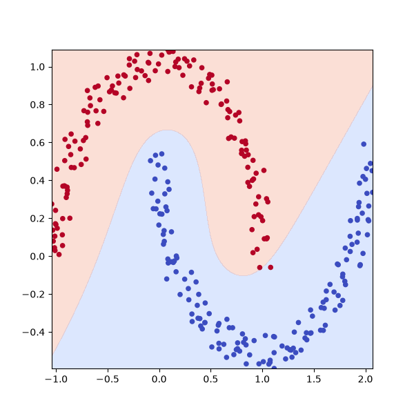

# neenergrad: an autodiff engine
`neenergrad` is a repo documenting the process of writing an autodiff engine by hand.

all of my notes, code and thoughts will be pushed to this repo. everything will be hand written, hand typed, etc. i just want a break from the depths of slop hell.

## examples
### `examples/regression.py`
simple model to perform linear regression on the line `y = 3x + 2`

```
python3 -m examples.regression
```

### `examples/two_moons.py`
two moon mlp

```
python3 -m examples.two_moons
```



### `examples/mnist.py`
mnist with 98% accuracy (5 epochs)

```
python3 -m examples.mnist
```
