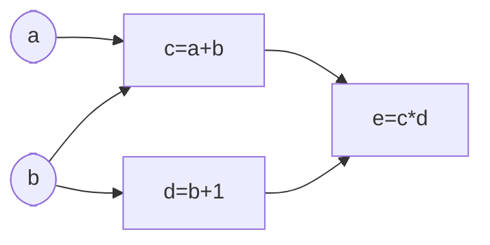

# backprop

notes taken while reading [christopher olah's 2015 blog](https://colah.github.io/posts/2015-08-Backprop/)

## computational graphs
consider the expression $e = (a+b) * (b+1)$

in total, there are 3 ops: $(a+b)$, $(b+1)$ and the product of these 2 intermediate results

let: $c = (a * b)$ and $d = (b+1)$, we now have $e = c*d$

